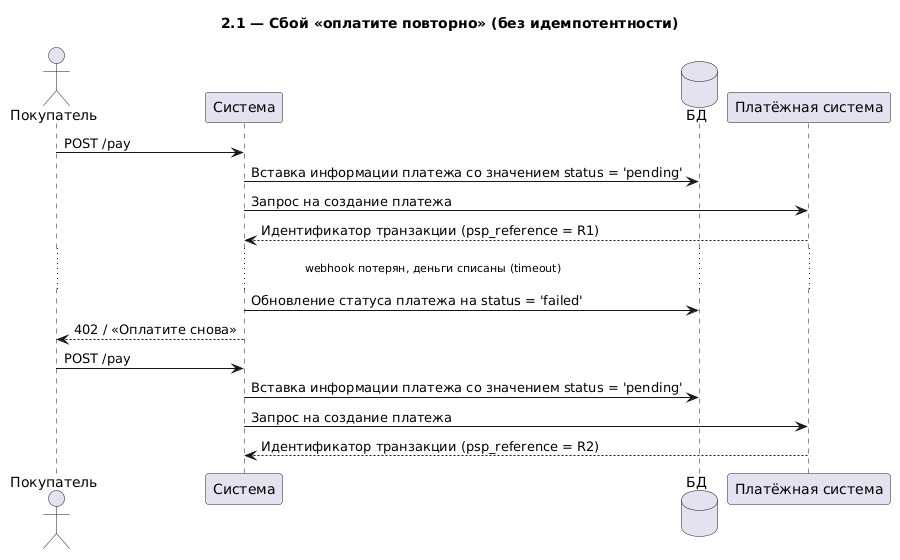
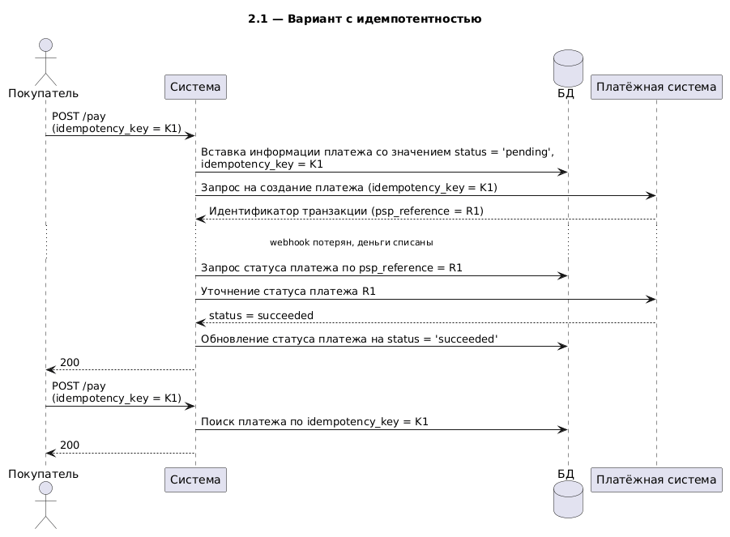
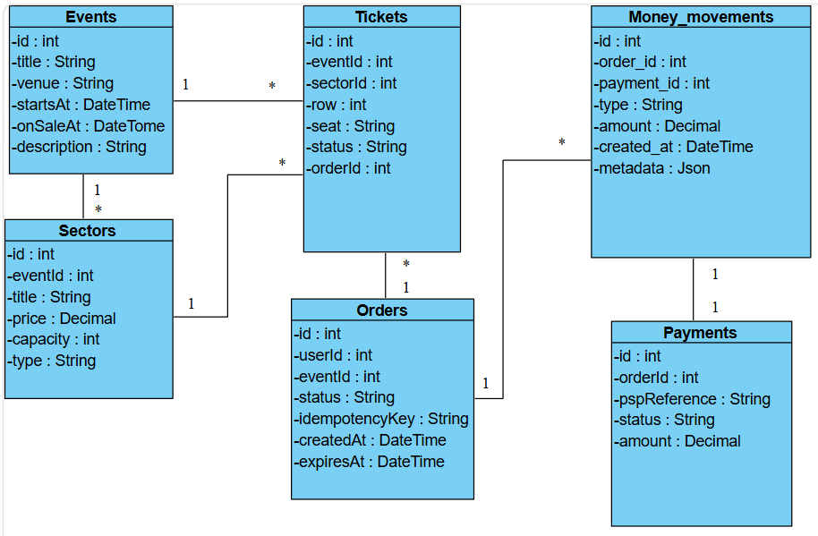
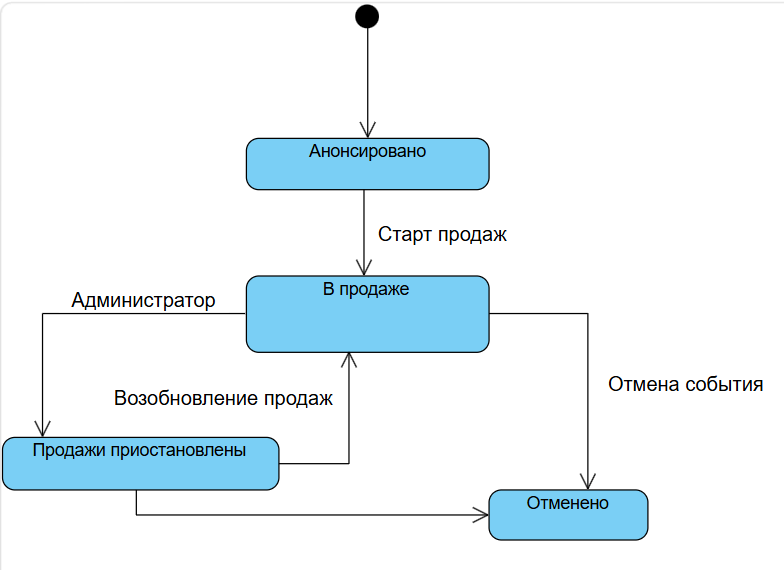
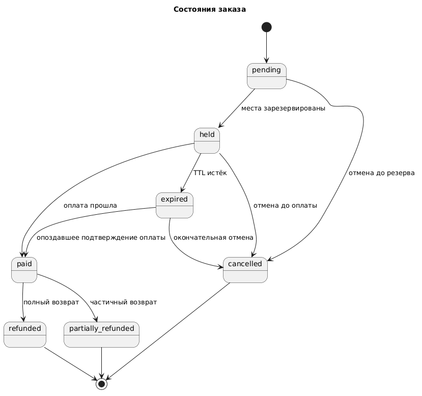

# Лабораторная работа №2. Путь записи: не продать одно место дважды

Вопрос работы. Как удержать инвариант «одно место — один владелец», когда в процессе участвуют два параллельных покупателя, внешняя платёжная система и сеть, которая теряет сообщения? 

2.1. Части покупателей после успешной оплаты пришли письма с просьбой оплатить билет повторно. Реконструируйте последовательность: где именно система решила, что оплаты не было? Нарисуйте диаграмму этого сбоя и покажите, какой механизм в вашем дизайне его исключает. 

2.2. Другие получили уведомление об аннулировании брони при списанных деньгах (рис. 4). Ответьте: (а) какой TTL у резерва и что происходит, если подтверждение приходит после его истечения; (б) как система узнаёт, что деньги всё-таки списаны; (в) что она делает с уже освобождённым и, возможно, перепроданным местом. Третий пункт — самый интересный, не пропускайте его. 

2.3. Покупательница получила билет через восемь часов после оплаты. Сформулируйте SLO на время «оплата → билет у пользователя», назовите метрику, по которой видно нарушение, и опишите, что делает система, когда очередь выдачи отстаёт на часы: копит, отключает продажи, извиняется? 

2.4. Организатор отправлял за возвратом к оператору, оператор отвечал, что деньги уже у организатора. Спроектируйте процедуру сверки: кто источник правды о состоянии платежа и какой отчёт позволяет за минуту ответить покупателю, где его деньги. 

2.5. Билеты продавались, когда возврат уже не работал. Добавьте в диаграмму состояний полный обратный путь: возврат по инициативе покупателя, по инициативе организатора, частичный, после отмены события. Для каждого — кто инициирует, что с местом, что с деньгами, за какое время.


**2.1 Диаграмма сбоя “Повторная оплата”**


Если в системе не использовать idempotency_key для оплаты, то может возникуть такая ситуация: вебхук от платежной системы теряется, деньги списаны, система ставит оплату как незавершенную и просит пользователя оплатить повторно.



Предлагаемый вариант: добавление idempotency_key,  в таблицу с платежами. Тогда при повторной оплате сразу вернется ответ, который был до этого.
Так же необходимо при потере вебхука не обновлять статус платежа на failed, а получать актуальный статус платежа по R1.
Таким образом, проблема решается за счет наличия idempotency-key у платежа + механизма polling, при потере вебхука мы идем и запрашиваем статус платежа в PSP (платежной системе).
В теории, можно обойтись без использования idempotency_key, а смотреть по order_id, находится ли платеж в состоянии pending, и уточнять статус платежа по psp_reference. Но наличие idempotency_key является базовым вариантом.

**2.2**

(а) Какой TTL у резерва и что происходит, если подтверждение приходит после его истечения
TTL резерва - 10–15 минут (хватает на возможные задержки сети, но не держит место слишком долго в пик продаж).
Что происходит при истечении TTL:
1. Место возвращается в статус `free`
2. Заказ переводится в expired
3. Пользователю может уйти уведомление «Бронь аннулирована: заказ не оплачен»

Если подтверждение оплаты приходит после истечения TTL:
1. Система не ставит место в `sold`, т.к. оно уже могло быть куплено другим человеком.
2. Запускается компенсирующая логика.


(б) Как система узнаёт, что деньги всё-таки списаны
Двумя способами:
1. Webhook от платёжной системы (основной путь).
2. Активный polling - фоновый воркер периодически ходит в PSP по psp_reference и проверяет статус платежей, которые в статусе pending или уже expired.
Даже если потеряется webhook или истечет таймаут, благодаря polling’у система будет знать статус оплаты, даже если пользователь получил сообщение об аннуляции брони.


(в) Что делать с уже освобождённым и, возможно, перепроданным местом

Возможные стратегии:
| Вариант                    | Что делаем                                                               | Плюсы                                | Минусы                                                                                       |
| -------------------------- | ------------------------------------------------------------------------ | ------------------------------------ | -------------------------------------------------------------------------------------------- |
| Вернуть деньги          | Полный возврат денег покупателю A                                        | Минимальные затраты на реализацию    | Нарушается принцип очереди, ради которого, например, был организован зал ожидания для продаж |
| Предложить другое место | Ищем свободное место той же или ближайшей ценовой категории и отдаём его | Пользователь получает место          | Места может быть не быть, риск race condition, сложнее реализовать                           |
| Ручной разбор           | Отправляем кейс в поддержку, с ним разбираются операторы                 | Можно принять индивидуальное решение | Дорого, медленно, не масштабируемо                                                           |


Предлагаемый вариант:
1. При возникновении такой ситуации сначала пытаемся атомарно заново занять то же место (если оно находится в статусе free).
2. Если место уже занято другим заказом, делаем полный возврат денег + предлагаем пользователю альтернативное место (если есть).
3. Если альтернативы нет, осуществляем только возврат денег.
Обязательно логируем такие случаи и проводим ручной разбор командой разработки.

**2.3 Билет через 8 часов после оплаты**

## SLO

99,9 % заказов, перешедших в статус `paid`, получают билет не позднее 5 минут после подтверждения оплаты. 99,99 % - не позднее 15 минут. Если через 30 минут после оплаты билет все еще не доставлен пользователю, считаем это инцидентом.
Билет спустя 8 часов после оплаты - недопустимо. 5/15 минут это баланс между быстрой доставкой билета пользователю и разумной нагрузкой на систему в части отправки подтверждений.
Если у нас в пике нагрузка 50 000–100 000 человек одновременно на странице концерта, а реальная пропускная способность оформления заказа - условно 500–2000 успешных оплат в минуту (после зала ожидания), то нормальный режим в пять минут обеспечивает нормальную работу: даже при всплеске 2000 оплат/мин за 5 минут накопится максимум ~10 000 писем с подтверждением покупки билетов. Это подъёмная нагрузка для воркеров и почтового провайдера.

## Метрика нарушения

**Основная метрика:**  
`ticket_delivery_lag_seconds` — время от момента перехода заказа в `paid` до момента успешной доставки билета пользователю (гистограмма: p50 / p95 / p99).

**Дополнительно:**
- Количество заказов в статусе `paid` без выданного билета старше 5 / 15 / 30 минут.
- Максимальный лаг в отправке заказа.

Алерт срабатывает, когда:
- p99 превышает 5 минут, или
- появляется хотя бы один заказ старше 15–30 минут.

---

### Если лаг доставки заказов (билетов) слишком большой:

**1. При небольшом отставании (минуты)**
- Автоматически масштабирует воркеров выдачи билетов.
- Пользователям, которые уже оплатили, показывает статус «Билет формируется».

**2. При серьёзном отставании (десятки минут)**
- Временно приостанавливает продажу новых билетов.

**3. При отставании на часы**
- Считаем это крупным инцидентом.
- Включаем компенсацию: автоматический возврат денег всем, кому билет так и не выдали за разумное время.
- Пользователям уходит сообщение с извинениями и информацией о возврате.

**2.4. Процедура сверки**
Для обеспечения процедуры сверки предлагается расширить схему данных и добавить ledger-таблицу, например money_movements.
Типы money_movements: charge, refund, transfer_to_organizer


Кто источник правды
| Вопрос                                                                   | Источник правды                                                         |
| ------------------------------------------------------------------------ | ----------------------------------------------------------------------- |
| Реально ли списаны / возвращены деньги                                   | Платёжная система (PSP)                                                 |
| Какой статус у заказа и билетов                                          | Проектируемая система продажи билетов, информация из таблиц БД (orders) |
| Кому в итоге ушли деньги (билетному оператору или организатору концерта) | Наличие ledger-записи о переводе организатору                           |


**Процедура сверки**
Раз в час (и по требованию) выгружаем из PSP все операции за период.
Сопоставляем их с нашей таблицей payments по psp_reference.
Строим отчёт расхождений.
Отчёт
GET /admin/orders/{order_id}/money-trace
Пример ответа:
```json
{
  "order_id": 123,
  "order_status": "paid",
  "amount": 55000,
  "created_at": "2026-08-17T12:03:11Z",
  "payment": {
    "payment_id": 45,
    "psp_reference": "pay_7f8a2b3c",
    "psp_status": "succeeded",
    "amount": 55000
  },
  "money_movements": [
    {
      "id": 1,
      "type": "charge",
      "amount": 55000,
      "created_at": "2026-08-17T12:03:11Z",
      "payment_id": 45
    },
    {
      "id": 2,
      "type": "transfer_to_organizer",
      "amount": 49500,
      "created_at": "2026-08-18T10:00:00Z",
      "payment_id": 45
    }
  ],
  "tickets": [
    { "id": 101, "status": "sold", "row": 5, "seat": "12" },
    { "id": 102, "status": "sold", "row": 5, "seat": "13" }
  ]
}
```
**2.5** Надо добавить в диаграмму состояний обратный путь: возврат по инициативе покупателя, по инициативе организатора, частичный, после отмены события. Для каждого — кто инициирует, что с местом, что с деньгами, за какое время.
Состояние события:


1. Кто имеет право перевести событие в «Продажи приостановлены» и через какой интерфейс
   Перевести событие в “Продажи приостановлены” могут сотрудники билетного оператора (администраторы, поддержка), так же организатор, если ему выдали соответствущие права. Это будет осуществляться через веб-интерфейс админ-панели, внутренний API PATCH /events/{id}/status. По этому запросу должна выполняться соответствующая логика по смене статуса события на sales_suspended и приостановке продаж.
2. Что происходит с активными резервами и уже проданными билетами
   Уже проданные билеты - остаются действительными.
   Билеты в состоянии резерва:
   Если оплата проходит до TTL - выдаем билет по стандартному флоу.
   Сразу отменяем все брони, переводим места в статус free.
   Выбранный вариант: активные брони доживают TTL, новые брони не создаются. Выбран был этот вариант, чтобы сохранить пользовательский опыт по стандартному флоу + меньше затрат на разрешение ситуаций гонок (например, что делать если оплата проходит прямо сейчас).
3. Кто в распределённой системе является единственным владельцем истины о состоянии события
   Единственный источник правды - таблица events в БД. Необходимо добавить status события. Сайт лишь отображает информацию о событии, которая хранится в базе данных. При создании заказа система проверяет, что событие имеет активный статус (“on_sale”, например).



| Сценарий                           | Кто инициирует                                                   | Что с местом                                                       | Что с деньгами                                                        | За какое время              |
| ---------------------------------- | ---------------------------------------------------------------- | ------------------------------------------------------------------ | --------------------------------------------------------------------- | --------------------------- |
| Возврат по инициативе покупателя   | Покупатель (кнопка «Вернуть» в личном кабинете)                  | Билеты из заказа переходят из sold в free                          | Полный возврат через PSP на карту покупателя                          | 5–10 минут                  |
| Возврат по инициативе организатора | Организатор или администратор через админ-панель                 | Все билеты заказа (заказов мероприятия) переходят в состояние free | Массовый полный возврат через PSP                                     | До 1 часа (обработка батча) |
| Частичный возврат                  | Покупатель или поддержка                                         | Часть билетов переходит в состояние free, остальные остаются sold  | Частичный возврат суммы через PSP                                     | 5–10 минут                  |
| После отмены события               | Иницирует система, когда событие переходит в состояние cancelled | Все билеты события переходят в состояние free                      | Автоматический полный возврат всем покупателям с оплаченными заказами | 30–60 минут                 |